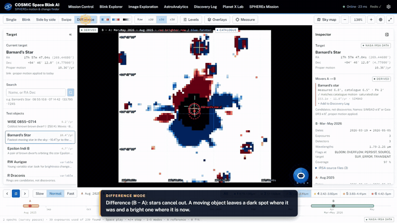

# COSMIC Space Blink AI

**SPHEREx motion & change finder** · NASA Space Apps Challenge 2026 · *Planet X and SPHEREx*

COSMIC lets anyone pick a patch of sky and *blink* real NASA SPHEREx infrared images taken on
different dates. Things that move (brown dwarfs, nearby stars, asteroids) or change brightness
(variable stars) stand out. Movers are ringed and named from SIMBAD and Gaia DR3 where possible.

- **Real data only.** Pixels come from NASA/IPAC IRSA (`spherex_dr1`), and every image carries a data-source chip.
- **Candidates, not discoveries.** A ring with no catalogue match is labelled *Unidentified candidate – needs further scientific investigation*. The app never calls anything "Planet X".
- **Simulated data only in the Planet X Lab**, labelled **SIMULATED** on every image and result.

---

## Demo video

<p align="center">
  <a href="demo/COSMIC-demo.mp4">
    
  </a>
</p>

<p align="center">
  <a href="demo/COSMIC-demo.mp4"><b>▶ Watch the full demo (1 min 14 s)</b></a>
  &nbsp;·&nbsp; Mission Control → Blink Explorer → Barnard's Star found and named → AstroAnalytics → Planet X Lab → Cosmo assistant
</p>

---

## Team

| Member | Role |
|---|---|
| **Aneesa Fatima** (Team Lead) | Astroanalysis |
| **Shah Fawad Khan** | Backend Developer |
| **Adeena Zaineb** | Image Processing Engineer |
| **Adina Saif Ullah** | Frontend Developer |
| **Munib Ur Rehman** | Cosmo chatbot and the SPHEREx AI service |

**Challenge:** [Planet X and SPHEREx](https://www.spaceappschallenge.org/) — NASA Space Apps Challenge 2026

---

## Contents

1. [Demo video](#demo-video)
2. [Team](#team)
3. [What the app does](#what-the-app-does)
4. [Quick start](#quick-start)
5. [How to test the challenge objects](#how-to-test-the-challenge-objects)
6. [How to check an unknown object](#how-to-check-an-unknown-object)
7. [Planet X Lab](#planet-x-lab)
8. [Architecture](#architecture)
9. [Repository layout](#repository-layout)
10. [Running the tests](#running-the-tests)
11. [Team workflow](#team-workflow)
12. [Data sources and credits](#data-sources-and-credits)

---

## What the app does

| Page | Route | Purpose |
|---|---|---|
| **Mission Control** | `/` | Start here. Search by object name or RA/Dec, pick the field size, browse the live sky map (Aladin Lite), or open one of the five challenge targets. |
| **Blink Explorer** | `/explorer` | The main tool. Shows every SPHEREx survey pass of the field as a short animation. Modes: Single, Blink, Side by side, Swipe, Difference (B − A). Detector selector (D1–D6), stretch and colour controls, Gaia/SIMBAD overlays, mover rings, a measure tool, timeline and inspector with metadata and contamination flags. |
| **Image Exploration** | `/compare` | Pick any two epochs, A and B. Shows A, B, a blink of the two and B − A side by side, a metadata table and a list of the movers found. |
| **AstroAnalytics** | `/analysis` | Aperture photometry of the target in every image: **light curve** (for variable stars), **spectrum** built from the 102 SPHEREx channels, and **astrometry** (positions and a proper-motion fit). Downloadable as CSV. |
| **Discovery Log** | `/candidates` | Your saved candidates (stored in your browser): positions, status (unvalidated / catalogued / rejected), notes, proper motion derived from measured positions, SIMBAD + Gaia cross-match, CSV export. |
| **Planet X Lab** | `/planetx` | Injection-recovery test: adds a **SIMULATED** distant planet to copies of real images and checks whether our detector finds it. |
| **SPHEREx Mission** | `/mission` | Mission facts, the six detectors and their wavelengths, how COSMIC processes data, how data is labelled, references. |
| **Settings** | gear icon | Backend URL, theme (light, dark, slate, night-vision red), coordinate format, image resolution, cache controls. |
| **Cosmo** | robot button | Assistant (optional module, maintained by the AI-assistant role; the app runs without it). Explains what is on screen, opens targets ("show Barnard's Star", "go to 133.79 -7.24") and answers SPHEREx questions through the SPHEREx AI service, with sources and a verified-facts check. |

Coordinates are always shown as RA and Dec, both sexagesimal and degrees. Any field can be shared
or embedded by URL, for example:

```
http://localhost:3000/explorer?ra=133.795129&dec=-7.245147&fov=4
http://localhost:3000/explorer?ra=269.4521&dec=4.69336&fov=4&embed=1
```

---

## Quick start

### Requirements

| Tool | Version |
|---|---|
| Python | 3.11 or newer (developed on 3.13) |
| Node.js | 20 or newer (developed on 22) |
| Redis | optional, version 7 (the app falls back to the disk cache) |

### 1. Backend (port 8000)

```powershell
cd backend
python -m venv .venv
.venv\Scripts\python -m pip install -r requirements-dev.txt
# create backend\.env with SPHEREX_AI_URL / SPHEREX_AI_KEY (ask the team lead; never commit it)
.venv\Scripts\python -m uvicorn app.main:app --port 8000
```

On macOS or Linux, use `python3 -m venv .venv` and `.venv/bin/python` instead.
The interactive API documentation is at http://127.0.0.1:8000/docs.

### 2. Frontend (port 3000)

```powershell
cd frontend
npm install
npm run dev
```

Open http://localhost:3000. Vite forwards `/api` to the backend on port 8000.

### 3. Redis (optional)

Redis makes repeat views instant. Without it, the app logs one warning and uses the disk cache.

- **Docker:** `docker run -d --name redis -p 6379:6379 redis:7 --maxmemory 512mb --maxmemory-policy allkeys-lru`
- **Without Docker (Windows + WSL):** see [backend/README.md](backend/README.md#redis-optional-recommended).

### First run

The first time a field is opened, the backend downloads the SPHEREx cutouts from IRSA. That takes
about 30–60 s for a 4′ field. After that the field is cached on disk and opens in about 1 s.

---

## How to test the challenge objects

Open **Mission Control** and click a test object, or use the links below. Each field opens in the
Blink Explorer and builds automatically.

| Object | What to look for | Where | Expected result |
|---|---|---|---|
| **Barnard's Star** | Fastest-moving star in the sky (~10.4″/yr north) | Blink Explorer → pick one detector (e.g. **D3**) → **Difference** mode | A red ring named *Barnard's Star* with an arrow pointing north. Measured shift ≈ 5–7″ between passes ≈ 6–7 months apart, marked **✓ matches catalogue motion**. The saturated core is masked; the shift is measured from the halo. |
| **WISE 0855−0714** | Coldest known brown dwarf (~8.2″/yr) | Blink Explorer, detectors **D5/D6** (≈ 4–5 µm) | Very faint in SPHEREx (only visible at 4–5 µm). The teal dashed circle shows the catalogue position on each date; blinking D5 shows the source near it. Too faint for an automatic ring in DR1: this is a limit of the data, not a bug. |
| **Epsilon Indi B** | Brown-dwarf pair (~4.7″/yr) | Blink Explorer, D4–D6 | Small shift between passes, compared with the predicted catalogue position. |
| **RW Aurigae** | Variable star: brightness, not motion | **AstroAnalytics → Light curve** | Flux changes between epochs, with error bars. |
| **R Draconis** | Mira variable (period ~8 months) | **AstroAnalytics → Light curve / Spectrum** | Large brightness change between passes. Very bright stars can be saturated: the page then says *no usable measurement – star saturated*. |

Quick checks that should work for everyone:

1. Mission Control → **Watch Barnard's Star move** → the explorer opens and blinks. Click detector **3**, then **Difference**: a red ring named Barnard's Star appears. (With *All* detectors mixed, the saturated star does not give a clean ring.)
2. Change the detector (D1–D6) on the timeline. The images and rings update.
3. Click a ring → **Add to Discovery Log** → the candidate appears in `/candidates`.
4. Copy the URL, open it in a new tab → the same field and settings appear.

A full checklist for testers is in [docs/Testing.md](docs/Testing.md).

---

## How to check an unknown object

COSMIC finds **candidates**. A candidate becomes interesting only after these checks:

1. **Open the field** by coordinates (Mission Control → *Coordinates*, e.g. `08 55 10.8  -07 14 42`).
2. **Blink and difference.** In the Blink Explorer use *Difference* (B − A). A mover leaves a pair:
   **dark** where it was, **bright** where it is now.
3. **Read the ring colour.**
   - **Red, named** → matched to SIMBAD (≤ 8″) or Gaia DR3 (≤ 6″) with proper motion applied. Known object.
   - **Orange, "Unidentified candidate"** → no catalogue match. Continue below.
4. **Check it is real, not an artefact:**
   - Does it appear in **more than one detector** (D1–D6)? Artefacts usually show in one only.
   - Look at the **flags** in the Inspector (HALO, TRANSIENT, OVERFLOW…). Flagged pixels mean caution.
   - Is a **bright star** nearby? Halos and ghosts can create false pairs.
   - Does the shift agree between **different epoch pairs**? A real mover moves consistently.
5. **Measure it.** Click the ring to save it to the **Discovery Log**, then use the *Measure* tool in
   each epoch. With two or more positions the log computes a proper motion.
6. **Cross-match** in the Discovery Log (SIMBAD + Gaia, 10″) and look it up in other surveys
   (the sky-map layers DSS2, 2MASS, AllWISE).
7. **Report it honestly:** *Unidentified candidate – needs further scientific investigation.*
   It is not a discovery until confirmed by follow-up observations.

---

## Planet X Lab

There is **no Planet X data in any NASA archive**. Planet Nine is a hypothesis (Batygin & Brown 2016).
So the lab does not search for Planet X. It **tests whether COSMIC could detect one**:

1. Choose a real field (or *Pure synthetic* noise images).
2. Set the distance (300–1000 AU), brightness (peak S/N), direction and detectors.
3. **Run injection test.** The backend copies the frames into a new **SIMULATED** set (the real set is
   never changed), adds a Gaussian source (FWHM 6.5″) moving at ≈ 2.5 × 206265 / d / 365 ″/day,
   runs the normal mover detector on visit pairs inside one survey pass and compares the result with the truth.
4. The result card reports, for example, *"Injected object recovered in 3 of 4 visit pairs, mean
   position error 0.3″"*, or *"Not recovered – too faint for these epochs"*.
5. **Sensitivity sweep** runs S/N 3, 5, 8, 12 × distance 300, 500, 800 AU and shows a recovery table.

Typical results: on synthetic frames, recovery is reliable from S/N ≈ 5. On real single-frame
SPHEREx visits, about S/N 20 per frame is needed, because the object moves only ~8″ (1.4 pixels)
in 3 days at 500 AU.

---

## Architecture

```
Browser (React + Vite, :3000)
   │  /api/*  (proxied by Vite in development)
   ▼
FastAPI backend (:8000) ──► NASA/IPAC IRSA      SIA2 search + FITS cutouts (spherex_dr1)
   │                    ──► SIMBAD TAP          CDS, Harvard mirror
   │                    ──► Gaia DR3 TAP        ESA, VizieR, IRSA
   │                    ──► SPHEREx AI service  chatbot (key kept server-side)
   ▼
Cache: Redis (fast, TTLs) in front of disk (backend/cache: arrays + JSON, survives restarts)
```

Processing for one field: search IRSA → keep images whose footprint contains the target → download
small cutouts (IMAGE, VARIANCE, FLAGS, ZODI) → subtract zodiacal light, mask bad pixels → reproject
to one north-up grid → stack per survey pass and detector → blink / difference / mover detection →
name movers from SIMBAD and Gaia with proper motion applied to each date.

Slow work (downloads, photometry) runs as background jobs: a request returns a job id, and the
frontend polls it for progress. Details are in [backend/README.md](backend/README.md) and
[frontend/README.md](frontend/README.md).

---

## Repository layout

```
COSMIC/
├── backend/
│   ├── app/            FastAPI app: irsa, cutout, reproject, sets, views, motion, catalog,
│   │                   spectrum, planetx, assistant, knowledge, cache, config, main
│   ├── tests/          pytest, synthetic data only (no network)
│   ├── scripts/        Redis helpers for WSL
│   ├── requirements.txt / requirements-dev.txt
│   └── .env            your local settings and keys (git-ignored, never commit)
├── frontend/
│   └── src/
│       ├── api/        typed client for the backend
│       ├── pages/      one file per page
│       ├── components/ stage, toolbar, timeline, inspector, assistant…
│       ├── state/      workspace, view, settings, candidates
│       ├── hooks/ lib/ helpers (coordinates, URL, keys)
├── docs/
│   └── Testing.md      tester checklist
└── README.md
```

---

## Running the tests

```powershell
cd backend
.venv\Scripts\python -m pytest -q          # backend: ~130 tests, no network
cd ..\frontend
npm run typecheck                          # frontend: TypeScript
npm run build                              # production build in dist/
```

---

## Team workflow

| Rule | Why |
|---|---|
| Never push to `main` directly: work on a branch named after your area (`backend/…`, `frontend/…`, `science/…`, `ai/…`) and open a pull request | `main` always works |
| Each role changes only its own folders, unless agreed in the team chat | avoids merge conflicts |
| Merge only in your role's agreed time window; after each window someone runs the smoke test in `docs/Testing.md` | broken builds are caught early |
| Tests (`pytest`) and the type check (`npm run typecheck`) must pass before merging | quality |
| Never commit `.env`, API keys, `backend/cache/`, `.venv/` or `node_modules/` | security and repository size |

Commit messages: `<area>: <what changed>`, e.g. `frontend: add sensitivity sweep table`.

---

## Data sources and credits

- **SPHEREx** images: NASA/IPAC Infrared Science Archive (IRSA), collection `spherex_dr1` — https://irsa.ipac.caltech.edu/Missions/spherex.html
- **Gaia DR3**: ESA (via ESA, VizieR and IRSA TAP services)
- **SIMBAD** and **Aladin Lite**: CDS, Strasbourg (Harvard mirror as fallback)
- Sky-map tiles **DSS2, AllWISE, 2MASS**: HiPS served by IRSA
- SPHEREx mission paper: arXiv:2511.02985 · Inspiration: WiseView (byw.tools/wiseview) and Backyard Worlds
- Planet Nine hypothesis: Batygin & Brown 2016, AJ 151, 22

NASA does not endorse this project. Built for the NASA Space Apps Challenge 2026.
